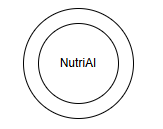

# 1. Описание предметной области

Деятельность в рамках предметной области организована вокруг ежедневного контроля пользователем своего питания, физической активности и физиологического состояния в соответствии с выбранной целью (снижение веса, набор мышечной массы, поддержание веса или оздоровление сердечно-сосудистой системы).

Основной единицей учёта является дневная запись. Она описывается следующими характеристиками: дата, антропометрические показатели, количество шагов, показатели пульса, описание самочувствия, фотографии приёмов пищи, результаты анализа ИИ-агента, ручные корректировки и итоговая статистика КБЖУ (калорийность, белки, жиры, углеводы).

Дата дневной записи является обязательным полем и не может относиться к будущему периоду. Значения веса, количества шагов и показателей пульса должны быть положительными числами. При внесении пользователем ручных изменений в массу блюда, калорийность или соотношение белков, жиров и углеводов система автоматически пересчитывает и сохраняет итоговую статистику за день.

Уникальной особенностью предметной области является программное ограничение доступа к перекусам. В рамках системы функционирует настольный программный модуль – эмулятор умного автомата перекусов. Процесс контролируется системой: при нажатии пользователем виртуальной кнопки модуль запрашивает разрешение у сервера. Если дневной лимит калорий не превышен, программный механизм выдачи срабатывает (виртуальная заслонка открывается, загорается зеленый индикатор). Если лимит исчерпан, выдача блокируется (виртуальная заслонка остается закрытой, загорается красный индикатор).

Управление данными и функциями осуществляется с разграничением прав доступа. Посетитель имеет доступ только к публичным разделам системы, справочной информации о возможностях сервиса и форме регистрации. Пользователь имеет доступ к собственному профилю и личным данным: он вносит и актуализирует параметры (возраст, рост, текущий вес, образ жизни, цель), создаёт и ведет дневные записи, загружает фотографии приёмов пищи, просматривает расчёты ИИ-агента, вносит ручные корректировки и получает персональные рекомендации.

На основании данных профиля пользователя, показателей дневной записи и фотографий еды ИИ-агент определяет предполагаемый состав и массу блюд, рассчитывает их КБЖУ и оценивает соответствие рациона индивидуальной суточной норме. При выявлении дефицита или избытка калорий и нутриентов система формирует рекомендации по питанию и физической активности, а также подбирает подходящие рецепты. Все сведения о пользователях, дневных записях и рецептах хранятся в базе данных.

**Название предметной области:** персональный контроль питания и физической активности.

**Название информационной системы:** NutriAI Tracker (ИС «Персональный контроль питания и физической активности»).

В границу ИС входит ведение и хранение профилей пользователей и дневных записей, обработка фотографий и текстовых данных с помощью ИИ-агента, расчёт и пересчёт КБЖУ, проверка корректности вводимых значений (дат, физических показателей), формирование рекомендаций и подбор рецептов, а также разграничение прав доступа между ролями. Кроме того, в границы системы включены работа мобильного приложения (Android/Java), серверной части (Linux/FastAPI/Python) и программная эмуляция настольного модуля на базе Raspberry Pi (Linux/Python/GPIO). Данный эмулятор обрабатывает нажатия виртуальной кнопки, отправляет запросы на сервер для проверки текущего дневного лимита калорий и программно управляет виртуальными элементами (открытием заслонки выдачи и сменой цветовых индикаторов). Пользователь находится вне системы и взаимодействует с ней как внешний субъект через мобильное приложение и интерфейс эмулятора. Непосредственный приём пищи, выполнение физических упражнений и замер физиологических показателей протекают за пределами системы. Название информационной системы и её граница представлены на рисунке 1.

  
   
  <em>Рисунок 1 – ИС «Персональный контроль питания и физической активности»</em>

---

# 2. Глоссарий

**Посетитель** – незарегистрированный пользователь, который имеет доступ только к главной странице приложения и форме регистрации.

**Пользователь** – зарегистрированный в системе человек, который может пройти авторизацию и получить доступ к полному функционалу этой системы.

**Профиль пользователя** – совокупность сведений о пользователе, включающая возраст, рост, вес, образ жизни и выбранную цель.

**Цель пользователя** – выбранное пользователем направление формирования рекомендаций: снижение веса, набор мышечной массы, поддержание веса или оздоровление сердечно-сосудистой системы.

**Антропометрические данные** – сведения о физических параметрах пользователя, в том числе его росте и весе.

**Внешний сервис** – сторонняя информационная система, позволяющая посетителю зарегистрироваться, а пользователю авторизоваться в NutriAI Tracker.

**Физическая активность** – сведения о двигательной нагрузке пользователя за день, выраженные количеством шагов.

**Показатели пульса** – введенные пользователем значения среднего, минимального и максимального пульса за день.

**Самочувствие** – текстовое описание пользователем своего физического состояния за выбранный день.

**Календарь-дашборд** – главный экран мобильного приложения, предназначенный для выбора даты, заполнения дневных данных и просмотра истории.

**Дневная запись** – совокупность сведений о питании, весе, физической активности, пульсе и самочувствии пользователя за одну календарную дату.

**Дневник питания** – упорядоченная по датам совокупность дневных записей пользователя.

**Рацион** – совокупность блюд и продуктов, употребленных пользователем за день.

**Прием пищи** – употребление одного или нескольких блюд в определенный период дня, например завтрак, обед, ужин или перекус.

**Фотография приема пищи** – загруженное пользователем изображение блюда, предназначенное для анализа ИИ-агентом.

**Блюдо** – отдельная позиция рациона, для которой определяются масса и значения КБЖУ.

**КБЖУ** – совокупность показателей пищевой ценности: калорийности, количества белков, жиров и углеводов.

**Суточная норма КБЖУ** – рассчитанные системой рекомендуемые значения калорийности, белков, жиров и углеводов на день с учетом профиля и цели пользователя.

**Суточная статистика КБЖУ** – суммарные значения калорийности, белков, жиров и углеводов всех блюд, внесенных за выбранный день.

**Баланс КБЖУ** – соотношение фактических показателей питания пользователя с рассчитанной суточной нормой.

**Дефицит КБЖУ** – недостаток одного или нескольких фактических показателей КБЖУ относительно суточной нормы.

**Избыток КБЖУ** – превышение одного или нескольких фактических показателей КБЖУ относительно суточной нормы.

**ИИ-агент** – программный компонент, который анализирует пользовательские данные и фотографии еды, оценивает КБЖУ и формирует рекомендации.

**Анализ приема пищи** – обработка фотографии ИИ-агентом с целью определения предполагаемого состава блюда, массы порции и значений КБЖУ.

**Рекомендация** – сформированный ИИ-агентом совет по корректировке питания или физической активности пользователя.

**Рецепт** – предложенное ИИ-агентом описание приготовления блюда, подобранного с учетом цели и текущего баланса КБЖУ пользователя.

**Ручная корректировка** – изменение пользователем определенных ИИ-агентом массы блюда, калорийности и количества белков, жиров и углеводов.

**Мобильное приложение** – клиентская часть системы, реализованная на Android (Java), через которую пользователь взаимодействует с сервером.

**Серверная часть** – центральный компонент (Linux/FastAPI/Python), обрабатывающий данные, хранящий логику и связывающий мобильное приложение с ИИ и модулем выдачи.

**Настольный модуль (Умный автомат перекусов)** – программный эмулятор на базе Raspberry Pi (Linux/Python/GPIO), воспроизводящий интерфейс устройства выдачи снеков с виртуальной кнопкой, виртуальной заслонкой и световыми индикаторами.

**GPIO (General-purpose input/output)** – программный интерфейс эмуляции ввода-вывода, используемый в модуле на базе Raspberry Pi для имитации управления сигналами заслонки и светодиодов.

**Виртуальная заслонка** – графический/программный элемент интерфейса настольного модуля, имитирующий открытие или блокировку выдачи перекуса.

**Итоговые данные за день** – сохраненная дневная запись с учетом выполненных пользователем ручных корректировок.

**История пользователя** – сохраненная совокупность дневных записей, позволяющая просматривать питание, активность, самочувствие и изменение веса за прошедшие даты.

**ИС** — информационная система.

**БД** — база данных.

**СУБД** — система управления базами данных.
