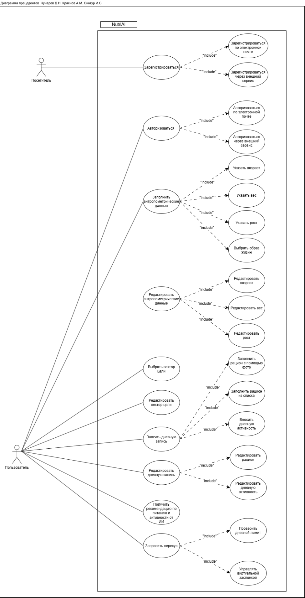

# 7. Диаграмма прецедентов

Диаграмма прецедентов представлена на рисунке 2.

  
   
  <em>Рисунок 2 – Диаграмма прецедентов</em>

---

# 8. Сценарии работы

## 8.1 Сценарии работы «Посетителя»

<b>Сценарий US-01. Зарегистрироваться по электронной почте</b>

| Поле | Содержание |
|---|---|
| **Наименование сценария** | Зарегистрироваться по электронной почте |
| **Участники сценария** | Посетитель, Мобильное приложение, Сервер |
| **Предусловия** | Посетитель находится на экране регистрации; есть подключение к сети Интернет. |
| **Результат** | В базе данных создана учетная запись, выполнен автоматический вход в систему. |
| **Бизнес-правила** | 1. Email должен быть уникальным в системе. 2. Введённый пароль и его подтверждение должны полностью совпадать. 3. Пароль должен соответствовать требованиям безопасности. |
| **Основной сценарий** | 1. Посетитель нажимает кнопку «Регистрация». 2. Вводит Email, пароль и его подтверждение. 3. Нажимает кнопку «Зарегистрироваться». 4. Система валидирует данные, создает профиль и авторизует пользователя. |
| **Альтернативный сценарий A1** | Email уже используется: 1. Система находит введенный Email в базе данных. 2. Выводит сообщение об ошибке «Пользователь с таким Email уже зарегистрирован». 3. Посетитель вводит другой Email. |

<b>Сценарий US-02. Зарегистрироваться через внешний сервис</b>

| Поле | Содержание |
|---|---|
| **Наименование сценария** | Зарегистрироваться через внешний сервис |
| **Участники сценария** | Посетитель, Мобильное приложение, Внешний сервис авторизации, Сервер |
| **Предусловия** | Посетитель находится на экране регистрации; есть подключение к сети Интернет. |
| **Результат** | В базе данных создана учетная запись, выполнен автоматический вход в систему. |
| **Бизнес-правила** | 1. Внешний сервис должен вернуть подтвержденный Email. 2. Пользователь дает согласие на передачу данных. |
| **Основной сценарий** | 1. Посетитель нажимает кнопку «Войти через...». 2. Открывается окно внешнего сервиса. 3. Посетитель подтверждает доступ. 4. Система получает данные, создает профиль и авторизует пользователя. |
| **Альтернативный сценарий A1** | Отказ в доступе: 1. Посетитель закрывает окно авторизации внешнего сервиса. 2. Система возвращает его на экран регистрации без создания профиля. |

## 8.2 Сценарии работы «Пользователя»

<b>Сценарий US-03. Авторизоваться по электронной почте</b>

| Поле | Содержание |
|---|---|
| **Наименование сценария** | Авторизоваться по электронной почте |
| **Участники сценария** | Пользователь, Мобильное приложение, Сервер |
| **Предусловия** | Учетная запись существует, пользователь на экране входа. |
| **Результат** | Пользователь авторизован, получен токен доступа, открыт календарь-дашборд. |
| **Бизнес-правила** | 1. Пароль передается по защищенному соединению (HTTPS). 2. При 5 неверных попытках – временная блокировка входа. |
| **Основной сценарий** | 1. Пользователь вводит Email и пароль. 2. Нажимает «Войти». 3. Сервер проверяет учетные данные. 4. Система открывает главный экран приложения. |
| **Альтернативный сценарий A1** | Неверный пароль или Email: 1. Сервер не находит совпадений. 2. Выводится сообщение об ошибке «Неверный логин или пароль». 3. Доступ к системе не предоставляется. |

<b>Сценарий US-04. Авторизоваться через внешний сервис</b>

| Поле | Содержание |
|---|---|
| **Наименование сценария** | Авторизоваться через внешний сервис |
| **Участники сценария** | Пользователь, Мобильное приложение, Внешний сервис |
| **Предусловия** | Аккаунт пользователя привязан к внешнему сервису. |
| **Результат** | Пользователь авторизован в системе. |
| **Бизнес-правила** | Токен внешнего сервиса должен быть валидным. |
| **Основной сценарий** | 1. Пользователь нажимает кнопку сервиса. 2. Подтверждает вход во внешнем окне. 3. Система сверяет ID и открывает доступ к приложению. |
| **Альтернативный сценарий A1** | Аккаунт не привязан: 1. Система не находит ID в базе данных. 2. Выводится предложение завершить регистрацию или войти по почте. |

<b>Сценарий US-05. Заполнить антропометрические данные</b>

| Поле | Содержание |
|---|---|
| **Наименование сценария** | Заполнить антропометрические данные |
| **Участники сценария** | Пользователь, Мобильное приложение, Сервер |
| **Предусловия** | Пользователь авторизован, данные ранее не вносились. |
| **Результат** | Данные сохранены в профиле, рассчитана суточная норма КБЖУ. |
| **Бизнес-правила** | 1. Возраст > 0, рост > 0, вес > 0. 2. Образ жизни выбирается из фиксированного списка. |
| **Основной сценарий** | 1. Пользователь открывает профиль. 2. Вводит возраст, рост, вес, выбирает образ жизни. 3. Нажимает «Сохранить». 4. Сервер сохраняет данные и рассчитывает норму. |
| **Альтернативный сценарий A1** | Отрицательные значения: 1. Введен вес -10 кг. 2. Система блокирует сохранение и подсвечивает поле красным. |

<b>Сценарий US-06. Редактировать антропометрические данные</b>

| Поле | Содержание |
|---|---|
| **Наименование сценария** | Редактировать антропометрические данные |
| **Участники сценария** | Пользователь, Мобильное приложение, Сервер |
| **Предусловия** | Пользователь авторизован, данные уже внесены. |
| **Результат** | Данные обновлены, суточная норма пересчитана. |
| **Бизнес-правила** | Измененные значения должны быть положительными числами. |
| **Основной сценарий** | 1. Пользователь открывает профиль. 2. Меняет текущий вес. 3. Нажимает «Сохранить». 4. Система обновляет данные и пересчитывает норму. |
| **Альтернативный сценарий A1** | Пустое обязательное поле: 1. Пользователь стирает значение роста. 2. Жмет «Сохранить». 3. Система требует заполнить поле. |

<b>Сценарий US-07. Выбрать вектор цели</b>

| Поле | Содержание |
|---|---|
| **Наименование сценария** | Выбрать вектор цели |
| **Участники сценария** | Пользователь, Мобильное приложение, Сервер |
| **Предусловия** | Пользователь авторизован, профиль заполнен. |
| **Результат** | Цель сохранена, рекомендации и нормы КБЖУ обновлены. |
| **Бизнес-правила** | Доступно 4 цели (снижение веса, набор массы, поддержание, оздоровление). |
| **Основной сценарий** | 1. Пользователь открывает экран выбора цели. 2. Выбирает «Снижение веса». 3. Нажимает «Применить». 4. Сервер пересчитывает норму и сохраняет цель. |
| **Альтернативный сценарий A1** | Ошибка сети: 1. Нет подключения к интернету. 2. Система пишет «Не удалось сохранить цель. Проверьте соединение». |

<b>Сценарий US-08. Редактировать вектор цели</b>

| Поле | Содержание |
|---|---|
| **Наименование сценария** | Редактировать вектор цели |
| **Участники сценария** | Пользователь, Мобильное приложение, Сервер |
| **Предусловия** | Пользователь авторизован, цель уже выбрана. |
| **Результат** | Новая цель сохранена, рекомендации изменены. |
| **Бизнес-правила** | Смена цели влечет автоматический перерасчет суточной нормы. |
| **Основной сценарий** | 1. Пользователь заходит в профиль. 2. Меняет цель с «Поддержание» на «Набор массы». 3. Система сохраняет настройку и выдает новые рекомендации. |
| **Альтернативный сценарий A1** | Выбрана та же цель: 1. Пользователь жмет «Сохранить» без изменений. 2. Система просто закрывает экран (изменений нет). |

<b>Сценарий US-09. Вносить дневную запись</b>

| Поле | Содержание |
|---|---|
| **Наименование сценария** | Вносить дневную запись |
| **Участники сценария** | Пользователь, Мобильное приложение, Сервер, ИИ-агент |
| **Предусловия** | Пользователь авторизован, открыт календарь-дашборд, выбрана текущая дата. |
| **Результат** | Данные (вес, шаги, пульс, самочувствие) и фотографии приемов пищи сохранены в БД. ИИ-агент рассчитал КБЖУ блюд. Суточная статистика обновлена. |
| **Бизнес-правила** | 1. Дата не может относиться к будущему. 2. Вес, шаги, пульс > 0. 3. Поддерживаемые форматы фото: JPEG, PNG, WEBP. 4. В течение дня можно добавлять неограниченное количество приемов пищи. |
| **Основной сценарий** | 1. Пользователь выбирает дату и вводит вес, шаги, пульс, самочувствие, нажимает «Сохранить». 2. Пользователь нажимает кнопку «Добавить прием пищи» и выбирает блюдо. 3. Пользователь делает фото блюда или загружает его из галереи. 4. Система отправляет фото на сервер. 5. ИИ-агент анализирует фото, определяет состав, массу порции и КБЖУ. 6. Система отображает распознанное блюдо и сохраняет его в дневную запись, автоматически пересчитывая суточную статистику. |
| **Альтернативный сценарий A1** | Выбрана будущая дата: 1. Пользователь пытается сохранить запись на завтра. 2. Система выдает ошибку «Нельзя вносить данные за будущую дату». |
| **Альтернативный сценарий A2** | ИИ не смог распознать блюдо: 1. ИИ-агент выдает низкую уверенность в распознавании. 2. Система предлагает пользователю ввести название блюда и КБЖУ вручную. |

<b>Сценарий US-10. Редактировать дневную запись</b>

| Поле | Содержание |
|---|---|
| **Наименование сценария** | Редактирование дневной записи и ручная корректировка данных ИИ |
| **Участники сценария** | Пользователь, Мобильное приложение, Сервер |
| **Предусловия** | Пользователь авторизован, запись за выбранную дату существует, в ней есть добавленный прием пищи. |
| **Результат** | Изменения (шаги, вес или граммовка/КБЖУ блюда) сохранены, суточная статистика автоматически пересчитана. |
| **Бизнес-правила** | 1. Валидация даты и положительных чисел сохраняется. 2. Результат анализа ИИ не считается абсолютно точным, пользователь имеет право менять массу блюда, калорийность и БЖУ. |
| **Основной сценарий** | 1. Пользователь открывает дневную запись. 2. Пользователь хочет изменить количество шагов - вводит новое значение. 3. Пользователь замечает, что ИИ ошибся с весом порции (например, распознал 200 г вместо 150 г). 4. Пользователь нажимает «Редактировать» на карточке блюда. 5. Пользователь вручную меняет массу (граммовку) и значения КБЖУ. 6. Система сохраняет изменения в БД и автоматически пересчитывает итоговую суточную статистику. |
| **Альтернативный сценарий A1** | Ввод некорректных данных: 1. Пользователь вводит отрицательную массу блюда или текст в поле калорий. 2. Система блокирует сохранение, подсвечивает поле и требует ввести корректное число. |

<b>Сценарий US-11. Получать рекомендации от ИИ</b>

| Поле | Содержание |
|---|---|
| **Наименование сценария** | Получение персональных рекомендаций и рецептов от ИИ |
| **Участники сценария** | Пользователь, Мобильное приложение, Сервер, ИИ-агент |
| **Предусловия** | Пользователь авторизован, за текущий день внесены данные об активности и добавлен хотя бы один прием пищи (с фото или скорректированными данными). |
| **Результат** | Отображены персональные советы по питанию, физической активности и рецепты на экране. |
| **Бизнес-правила** | 1. Рекомендации строятся на основе дефицита/профицита КБЖУ и выбранной цели пользователя. 2. Если данных мало, система должна явно указать, что нужно сделать для получения рекомендаций. |
| **Основной сценарий** | 1. Пользователь открывает экран «Рекомендации». 2. Сервер собирает данные о текущем балансе КБЖУ (на основе загруженных фото и ручных корректировок). 3. ИИ-агент сравнивает факт с суточной нормой. 4. ИИ-агент формирует совет по питанию и подбирает подходящий рецепт. 5. Система выводит рекомендации на экран. |
| **Альтернативный сценарий A1** | Недостаточно данных: 1. Пользователь не загрузил ни одного фото и не внес данные о питании за день. 2. Система выводит заглушку: «Добавьте приемы пищи или активность, чтобы ИИ-агент смог проанализировать ваш день и дать рекомендации». |

<b>Сценарий US-12. Запросить перекус</b>

| Поле | Содержание |
|---|---|
| **Наименование сценария** | Запросить перекус |
| **Участники сценария** | Пользователь, Программный эмулятор (Raspberry Pi), Сервер |
| **Предусловия** | Пользователь авторизован, дневная запись создана, эмулятор запущен. |
| **Результат** | Виртуальная заслонка открыта (зеленый свет) или закрыта (красный свет). |
| **Бизнес-правила** | 1. Выдача разрешается, если калории < нормы. 2. При отсутствии сети – блокировка выдачи. |
| **Основной сценарий** | 1. Пользователь жмет виртуальную кнопку. 2. Эмулятор шлет запрос на сервер. 3. Сервер видит, что лимит не превышен. 4. Эмулятор открывает заслонку и включает зеленый свет. |
| **Альтернативный сценарий A1** | Лимит превышен: 1. Сервер видит, что калории > нормы. 2. Отправляет отказ. 3. Эмулятор оставляет заслонку закрытой и включает красный свет. |
| **Альтернативный сценарий A2** | Нет связи с сервером: 1. Эмулятор не получает ответ. 2. Заслонка закрыта, красный свет, сообщение об ошибке сети. |

