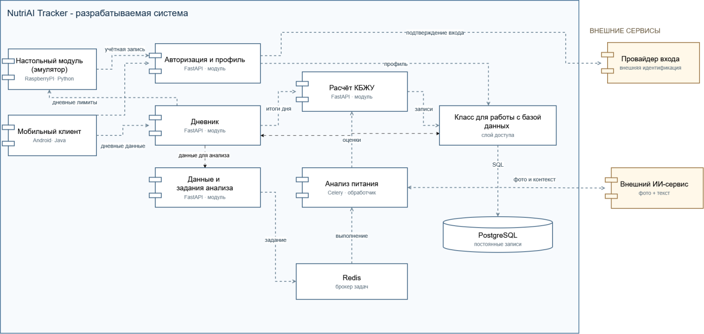

# 10. Архитектура информационной системы

Информационная система «NutriAI Tracker» спроектирована на основе клиент-серверной компонентной архитектуры с использованием асинхронной очереди задач для ресурсоемких операций. Общая схема представлена на рисунке 3.

  
   
  <em>Рисунок 3 – Архитектура ИС</em>

Архитектурно система разделена на три основных уровня: клиентский уровень, серверный уровень (ядро системы) и уровень хранения данных и внешних интеграций.

## 1) Клиентский уровень

Включает в себя два независимых клиентских компонента, взаимодействующих с серверной частью по протоколу HTTPS через программный интерфейс REST API:

1. **Мобильный клиент (Android / Java)** – основное приложение пользователя, обеспечивающее интерфейс для регистрации и авторизации, ведения профиля, заполнения дневника питания и активности, отправки фотографий блюд и просмотра персональных рекомендаций.
2. **Настольный модуль-эмулятор (Raspberry Pi / Python / GPIO)** – специализированный клиентский узел, имитирующий работу «умного автомата перекусов». Модуль считывает нажатия виртуальной кнопки, запрашивает у сервера статус дневного лимита калорий текущего пользователя и управляет состояниями виртуальной заслонки и цветовых индикаторов (зеленый/красный).

## 2) Серверный уровень (Backend и асинхронная обработка)

Серверная часть реализована на языке Python с использованием фреймворка FastAPI и упакована в контейнеры Docker. Логически сервер разделен на следующие функциональные модули:

1. **Модуль «Авторизация и профиль» (FastAPI)** – отвечает за регистрацию, аутентификацию пользователей (по электронной почте или через внешнего провайдера входа), выпуск токенов доступа, проверку прав запросов от настольного эмулятора, а также управление антропометрическими данными и целями пользователя.
2. **Модуль «Дневник» (FastAPI)** – обрабатывает запросы на создание, чтение и редактирование дневных записей (вес, шаги, пульс, самочувствие, приемы пищи). Также данный модуль обрабатывает запросы от настольного эмулятора, возвращая информацию об остатке дневного лимита калорий.
3. **Модуль «Расчет КБЖУ» (FastAPI)** – реализует бизнес-логику вычисления индивидуальной суточной нормы калорий и нутриентов на основе параметров профиля и выбранной цели, агрегирует суточную статистику по итогам дня и выполняет автоматический пересчет показателей после ручной корректировки данных пользователем.
4. **Модуль «Данные и задания анализа» (FastAPI)** – принимает загружаемые пользователем фотографии приемов пищи и запросы на формирование рекомендаций, выполняет их предварительную валидацию и ставит задачи на обработку в фоновую очередь, не блокируя основной поток работы приложения.
5. **Брокер задач (Redis)** – промежуточное связующее звено в оперативной памяти, обеспечивающее передачу фоновых задач от веб-сервера FastAPI к обработчику очереди.
6. **Обработчик «Анализ питания» (Celery Worker)** – фоновый процесс, который извлекает задачи из брокера Redis, формирует контекстный запрос (данные профиля, текущий баланс КБЖУ и фотографии) и отправляет его во внешний ИИ-сервис.

## 3) Уровень доступа к данным и хранения

1. **Слой доступа к данным (Класс для работы с БД / ORM)** – изолирует бизнес-логику приложения от деталей реализации хранилища, преобразуя объекты системы в параметризованные SQL-запросы.
2. **Реляционная СУБД (PostgreSQL)** – обеспечивает надежное долговременное хранение учетных записей, профилей пользователей, истории дневных записей, параметров приемов пищи, рассчитанных норм КБЖУ и сгенерированных рекомендаций.

## 4) Внешние сервисы (за границей разрабатываемой системы)

1. **Провайдер входа** – внешний сервис идентификации (OAuth-провайдер), обеспечивающий подтверждение входа и регистрацию пользователя в один клик.
2. **Внешний ИИ-сервис** – облачный мультимодальный сервис искусственного интеллекта, выполняющий распознавание блюд по фотографии, оценку их пищевой ценности и генерацию текстовых советов и рецептов по запросу сервера.
